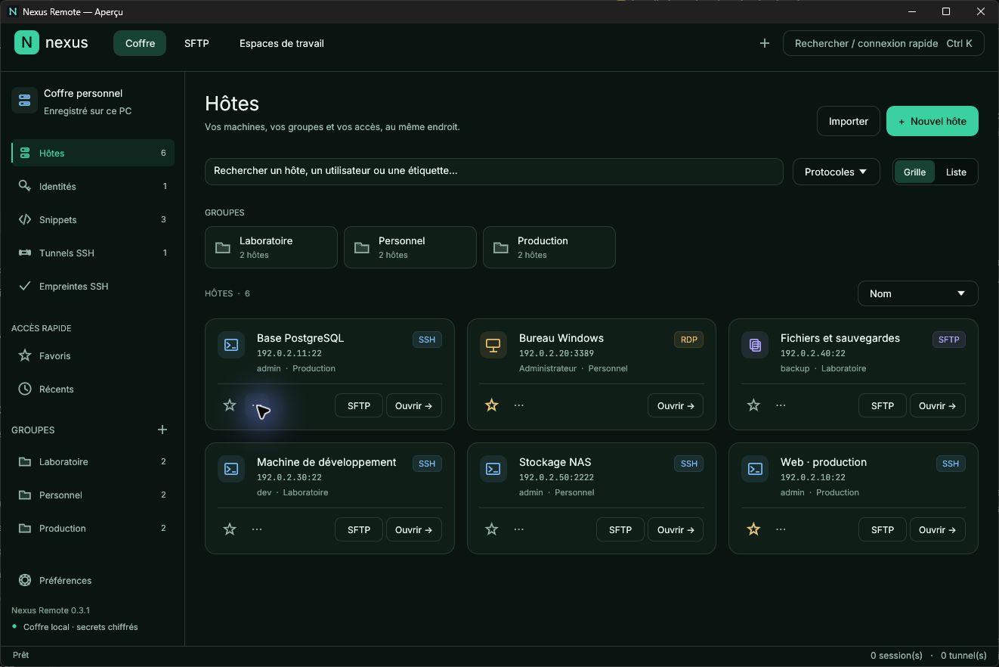
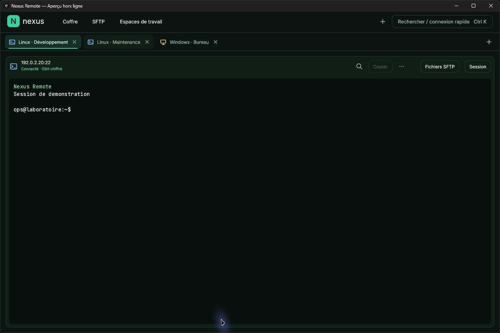
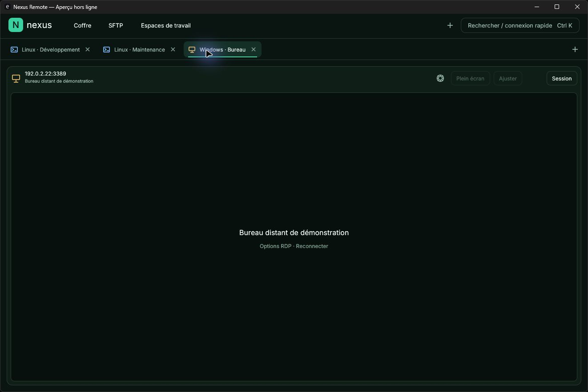

<p align="center"></p>

# Nexus Remote

**Vos terminaux, fichiers et bureaux distants dans une seule application.**

Nexus Remote est un gestionnaire de connexions **SSH, SFTP et RDP pour Windows**, écrit en Rust. Organisez vos machines, ouvrez plusieurs sessions et retrouvez vos accès dans une interface native en français. Le carnet est conservé sur votre PC, sans compte ni service cloud à configurer.



## Un espace pour vos machines

| Protocole | Ce que vous pouvez faire |
| --- | --- |
| **SSH** | Utiliser un terminal interactif avec couleurs, historique, sélection, recherche, zoom et thèmes. |
| **SFTP** | Parcourir les fichiers locaux et distants, transférer des fichiers et modifier les petits fichiers texte. |
| **RDP** | Afficher un bureau Windows dans un onglet, ajuster la vue ou passer en plein écran. |

Le carnet réunit groupes, étiquettes, notes, favoris et connexions récentes. Les identités permettent de réutiliser un utilisateur et son authentification entre plusieurs hôtes. La connexion rapide ouvre un accès depuis une recherche, une adresse ou une URI `ssh://`, `sftp://` ou `rdp://`.

Pour travailler sur plusieurs machines, disposez deux sessions côte à côte ou empilées et enregistrez les hôtes d’un espace de travail. Les snippets regroupent vos commandes ; leur exécution demande confirmation. Les tunnels SSH proposent les redirections locales et distantes. L’écoute locale est limitée à loopback. Chaque démarrage d’un tunnel distant `-R` demande une confirmation : l’adresse réellement écoutée dépend de la configuration du serveur SSH (`GatewayPorts`).

<details>
<summary><strong>Voir les interfaces SSH et RDP</strong></summary>

| Terminal SSH | Bureau RDP |
| --- | --- |
|  |  |

</details>

*Aperçus avec données de démonstration. Les vues SSH et RDP sont présentées hors connexion et ne montrent pas une session distante réelle.*

## Démarrer

**Configuration requise :** Windows 10 ou 11 en 64 bits, avec un pilote prenant en charge OpenGL 3.3.

Pour générer l’application, suivez les instructions [Compiler depuis les sources](#compiler-depuis-les-sources), puis ouvrez `target\release\nexus-remote.exe`.

L’application est portable et l’exécutable n’est pas signé. Son interface utilise Rust et egui/eframe ; aucun environnement Electron, WebView ou .NET n’est nécessaire. Le composant RDP utilise les fonctions intégrées de Windows.

## Première connexion

1. Cliquer sur **Nouvel hôte**, puis choisir SSH, SFTP ou RDP.
2. Renseigner l’adresse, le port et l’utilisateur, puis choisir l’authentification.
3. Enregistrer l’hôte et le double-cliquer pour ouvrir une session.

Pour SSH et SFTP, comparez l’empreinte du serveur à la première connexion avant de l’accepter. Une clé de serveur différente de celle enregistrée est refusée. Pour RDP, Windows doit authentifier le serveur pour poursuivre la connexion. Si votre serveur présente un certificat non vérifiable, l’option avancée **Autoriser un certificat RDP non vérifié** existe pour cet hôte seulement : elle permet de poursuivre après l’avertissement Windows. Vérifiez alors l’identité du serveur par un autre canal avant de saisir vos identifiants. Cette option est désactivée par défaut, y compris pour les anciens profils.

**Raccourcis utiles :** `Ctrl+K` pour la connexion rapide, `Ctrl+N` pour un nouvel hôte, `Ctrl+Maj+F` pour rechercher dans le terminal et `Ctrl+Maj+C/V` pour copier ou coller.

## Vos données restent sur votre PC

Le carnet se trouve dans `%LOCALAPPDATA%\NexusRemoteRust`. Les adresses, noms, notes, commandes et chemins y restent en clair. Les secrets enregistrés sont chiffrés avec **Windows DPAPI**, pour le compte Windows courant. Les fichiers de clés privées restent à leur emplacement d’origine.

L’import prend en charge JSON et les blocs explicites `Host` d’OpenSSH. Les exports d’hôtes excluent les secrets et le contenu des clés privées. Un export n’est donc pas une sauvegarde complète des identifiants. Lors d’un import JSON, le partage du presse-papiers RDP et l’exception de certificat non vérifié sont désactivés : réactivez-les uniquement si nécessaire après avoir vérifié l’hôte.

Pour mettre à jour, fermer Nexus puis remplacer les fichiers de l’application : le carnet personnel est conservé. Fermer l’application déconnecte les sessions ouvertes ; il faudra les rouvrir après le redémarrage.

## Compiler depuis les sources

Prérequis : **Rust stable** avec rustup pour `x86_64-pc-windows-msvc`, **Visual Studio 2022 Build Tools** avec les outils C++ x64 et le **SDK Windows**, ainsi que **Perl** et `tar.exe` dans `PATH` pour OpenSSL.

Depuis le dossier du dépôt, dans un **Developer PowerShell for VS 2022** configuré pour x64 :

```powershell
powershell -ExecutionPolicy Bypass -File scripts/build-openssl.ps1
powershell -ExecutionPolicy Bypass -File scripts/build.ps1 -Test
```

Le premier script télécharge la source officielle d’OpenSSL 3.5.9 LTS, vérifie son SHA-256 épinglé, puis compile et teste la bibliothèque native dans `.local-build`. Il refuse de réutiliser un dossier source déjà extrait : pour refaire la compilation, choisissez un nouveau `-OutputDir`. Le second contrôle les empreintes des bibliothèques installées et teste la version OpenSSL réellement liée avant de valider le build Nexus ; il n’accepte pas le repli vers l’ancienne branche OpenSSL 3.6 hors support. Ces scripts n’installent pas Rust, Perl ou les outils Visual Studio. Cargo télécharge les dépendances verrouillées au premier build ; `-Offline` fonctionne une fois le cache et l’archive OpenSSL présents. L’exécutable est produit dans `target\release\nexus-remote.exe`. Le runtime C et les bibliothèques SSH sont liés statiquement.

Les tests réseau facultatifs et les détails de fonctionnement sont décrits dans le [guide détaillé](docs/GUIDE.md).

## État du projet

Nexus Remote est en développement. Les échanges SSH, SFTP et les tunnels ont été testés avec un serveur local réel. Le contrôle RDP intégré a été testé sans connexion ; une session RDP distante complète reste à valider.

La synchronisation cloud, la collaboration, les chaînes de rebond SSH, SOCKS dynamique et les transferts récursifs de dossiers ne sont pas disponibles. Les protocoles Mosh, Telnet et série ne sont pas pris en charge. Nexus Remote est un projet indépendant, sans affiliation avec Termius.

## Licence

Le code applicatif est distribué sous [licence MIT](LICENSE). Les licences des dépendances figurent dans [THIRD_PARTY_NOTICES.md](THIRD_PARTY_NOTICES.md), [THIRD_PARTY_LICENSES.txt](THIRD_PARTY_LICENSES.txt) et [RUST_LIBRARY_COPYRIGHT.html](RUST_LIBRARY_COPYRIGHT.html). Les polices Inter et JetBrains Mono sont distribuées sous SIL Open Font License 1.1.
